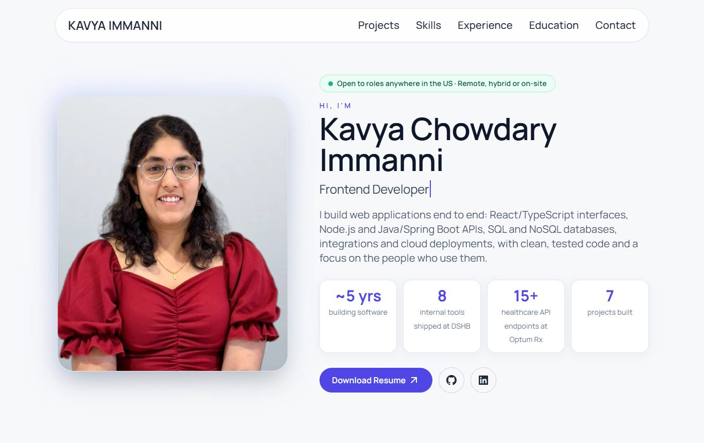
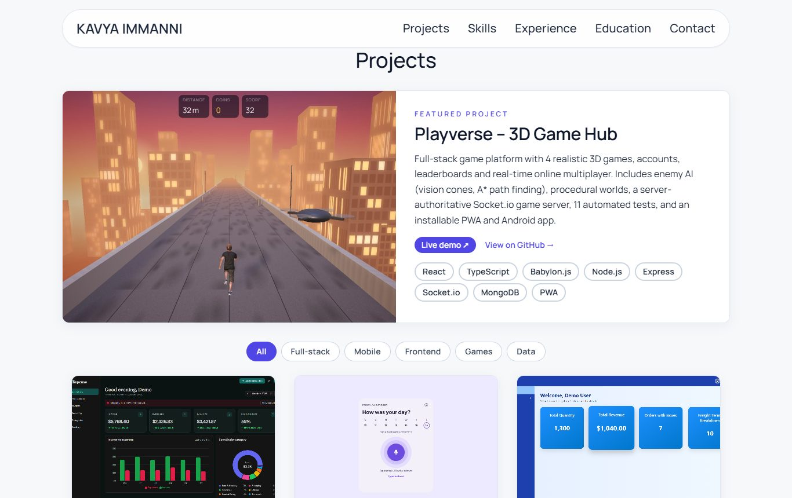
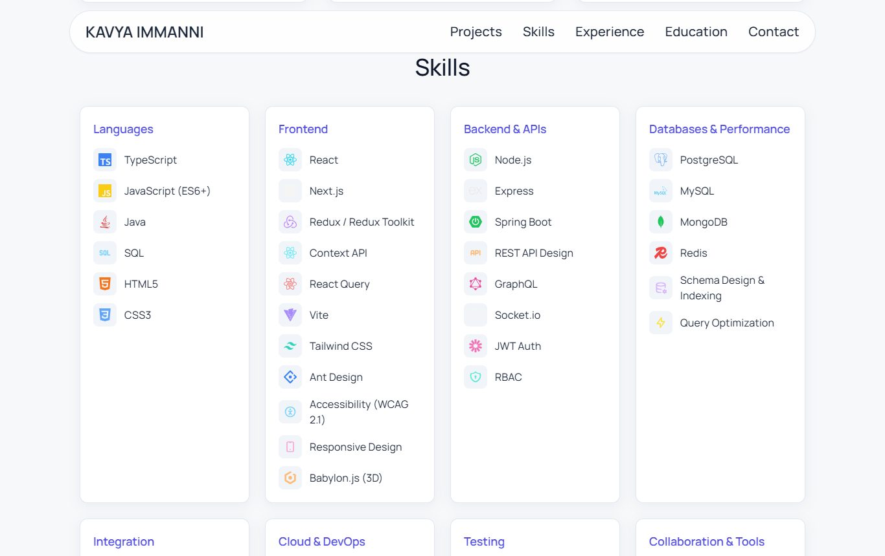
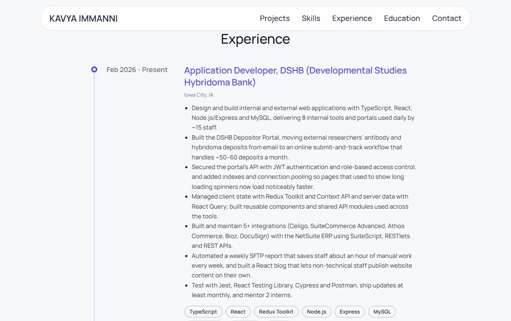
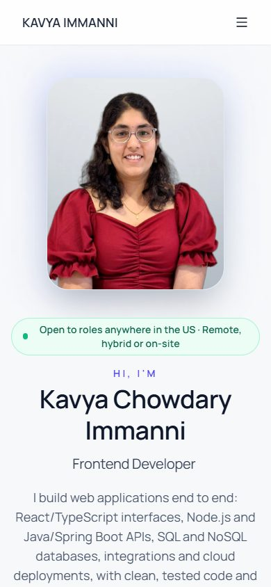

# Kavya Immanni – Portfolio


My personal portfolio: a full-stack software developer with ~5 years of experience in React, TypeScript, Node.js, Java/Spring Boot, SQL/NoSQL databases and integrations.

**Live site:** https://kc-2705.github.io/My_Portfolio_New/



## What's inside

- **Hero:** introduction with an availability badge, a typing headline that cycles through my roles, animated count-up stats, resume download, and GitHub/LinkedIn links.
- **Projects:** a featured project (Playverse, a 3D game hub with online multiplayer) plus project cards with live demos, GitHub links and tech stacks, and filter buttons (Full-stack, Frontend, Mobile, Games, Data).
- **Skills:** grouped by Languages, Frontend, Backend & APIs, Databases, Integration, Cloud & DevOps, Testing, and Collaboration & Tools.
- **Experience:** a timeline of my roles at DSHB, Optum Rx and TIBCO.
- **Education and Contact.**



<p>
  
  
</p>

<p align="center"></p>

## Featured projects

| Project | What it is | Links |
|---|---|---|
| Playverse | Full-stack 3D game hub: 4 games, accounts, leaderboards, real-time multiplayer, Android app | [Live](https://playverse-app.onrender.com) · [GitHub](https://github.com/kc-2705/playverse) |
| Expenso | MERN personal-finance tracker with budgets, CSV import and charts | [GitHub](https://github.com/kc-2705/expense-management-app) |
| Ask Past Me | Offline-first Android voice journal (React Native, SQLite) | [GitHub](https://github.com/kc-2705/ask-past-me) |
| OrderDesk | React order-management dashboard | [Live](https://kc-2705.github.io/orders-management-app/) · [GitHub](https://github.com/kc-2705/orders-management-app) |
| Fun Web Projects | Creative HTML/CSS/JS experiments | [Live](https://kc-2705.github.io/fun-web-programming/) · [GitHub](https://github.com/kc-2705/fun-web-programming) |

## Design

- Light, clean theme: white cards, dark navy text and one indigo accent, using the Manrope font.
- Responsive from phones to wide screens, with no sideways scrolling.
- Scroll animations with GSAP ScrollTrigger; motion respects the reduced-motion setting.

## Tech stack

React 18 · Vite · Tailwind CSS · GSAP (ScrollTrigger) · React Icons · Remix Icon

All content (profile, projects, skills, experience, education) lives in one file, `src/constants/index.jsx`, so updating it doesn't touch the components.

## Run locally

```bash
npm install
npm run dev
```

## Deploy

```bash
npm run deploy   # builds and publishes to GitHub Pages
```
