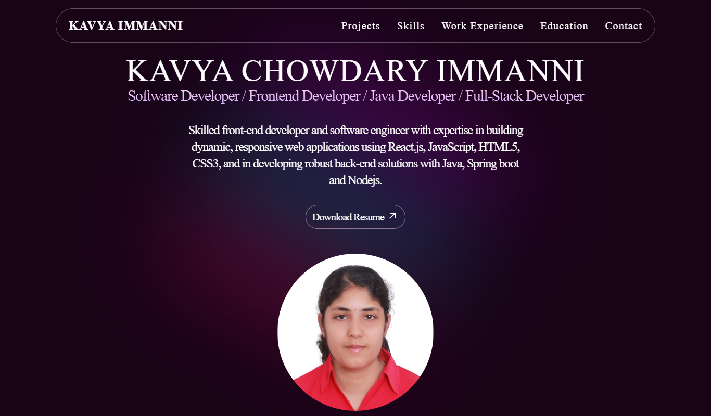

# Kavya Immanni – Portfolio


My personal portfolio website, built with React, Tailwind CSS and GSAP animations.

**Live site:** https://kc-2705.github.io/My_Portfolio_New/



## Sections

- **Profile:** introduction with resume download
- **Projects:** cards for my main projects with tech stack and GitHub links
- **Skills:** front-end, back-end, database and DevOps tools
- **Experience and Education:** timeline of roles and degrees
- **Contact**

Content lives in one file, `src/constants/index.jsx`, so updating projects or experience doesn't touch the components.

## Tech stack

React 18 · Vite · Tailwind CSS · GSAP (ScrollTrigger) · Swiper · React Icons

## Run locally

```bash
npm install
npm run dev
```

## Deploy

```bash
npm run deploy
```

This builds the site into `build/` and publishes it to the `gh-pages` branch with [gh-pages](https://github.com/tschaub/gh-pages).
